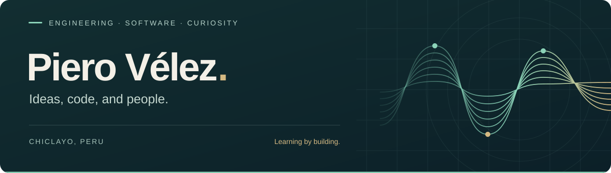
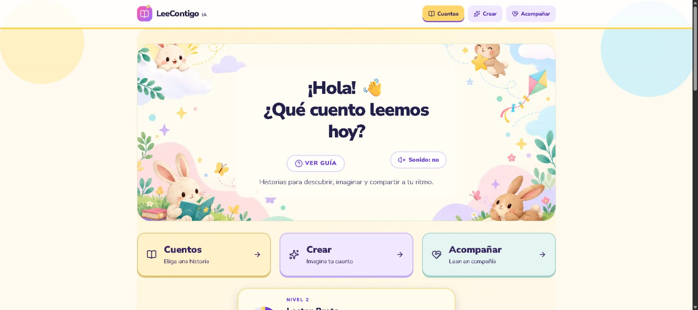
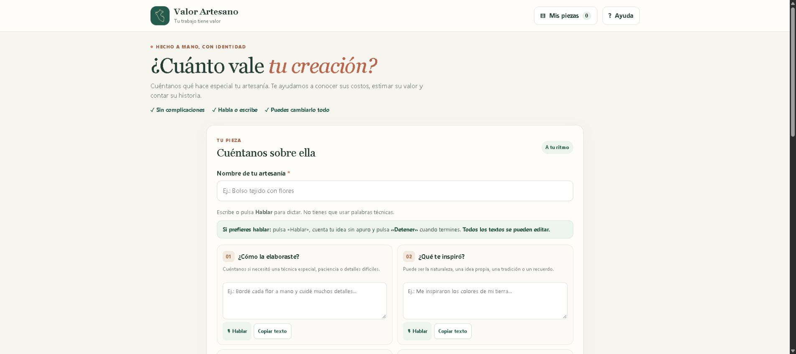

  

  <a href="https://www.linkedin.com/in/piero-v%C3%A9lez-su%C3%A1rez-36a2a6291/">Connect on LinkedIn ↗</a>
  &nbsp; · &nbsp;
  <a href="https://github.com/pierovelezzz#projects">See projects</a>
  &nbsp; · &nbsp;
  <a href="https://github.com/pierovelezzz/pierovelezzz/blob/main/README.es.md">Español</a>

I'm Piero. I study **Systems and Computing Engineering at USAT** in Chiclayo, Peru. I like building tools that help people learn, explore data, and solve problems in their communities. Hackathons give me a chance to try out ideas with a team and see what we can build together.

I'm focusing on **backend development with Java, Python, and SQL**. I want to understand what I build all the way from the database to the people using it.

## Projects

Here are two projects I worked on with a team. Both are live and ready to try.

<table>
<tr>
<td width="50%" valign="top">

<h3>EarthRhythm</h3>

DATA · MUSIC · ACCESSIBILITY

What would an ocean map sound like? We turned its colors into music so people could explore the Pacific by listening.

Built for <strong>NASA Space Apps 2026</strong>.

<a href="https://earthrhythm-nasa.vercel.app/">Listen to the Pacific ↗</a> &nbsp;·&nbsp; <a href="https://github.com/pierovelezzz/EarthRhythm">View source</a>

</td>
<td width="50%" valign="top">

<h3>LeeContigo IA</h3>

EDUCATION · AI · READING

A reading tutor that uses stories, questions, and hints to help children make sense of what they read.

<strong>First place at futurX 2026</strong> with IngeFuturX.

<a href="https://lee-contigo-ia.vercel.app/">Read a story ↗</a> &nbsp;·&nbsp; <a href="https://github.com/Alvaro-mendoza-12/Lee-Contigo-IA">View source</a>

</td>
</tr>
</table>

<strong>More projects · Valor Artesano</strong>

 

A prototype for describing handmade goods, calculating costs, and creating a PDF product sheet. The browser uses rules to suggest descriptions and prices.

[Try Valor Artesano ↗](https://valor-artesano.vercel.app/)

## Milestones

- **First place at the futurX 2026 Hackathon**, with my team IngeFuturX and our project LeeContigo IA. [USAT story (Spanish) ↗](https://www.usat.edu.pe/noticias/estudiantes-de-ingenieria-de-sistemas-y-computacion-usat-obtienen-el-primer-lugar-en-la-hackathon-futurx-2026/)
- **Ranked first in my degree program in the second semester of 2025**, as recognized by USAT. [USAT announcement (Spanish) ↗](https://www.usat.edu.pe/noticias/usat-reconoce-a-los-primeros-puestos-de-sus-18-escuelas-profesionales/)

## What I'm learning

**Foundations:** `Java` · `Python` · `SQL` · `Git`  
**Working on:** Spring, PostgreSQL, authentication, and API testing.  
**I want to explore:** education, accessibility, and applied research.

If you're working on something along these lines, [I'd love to hear from you](https://www.linkedin.com/in/piero-v%C3%A9lez-su%C3%A1rez-36a2a6291/).
