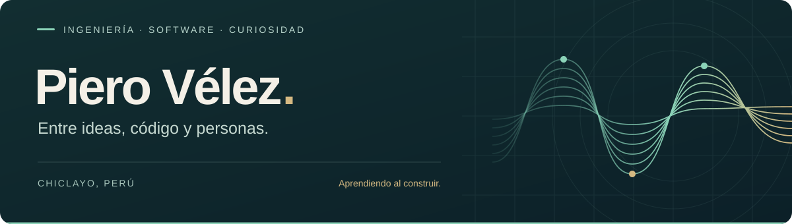
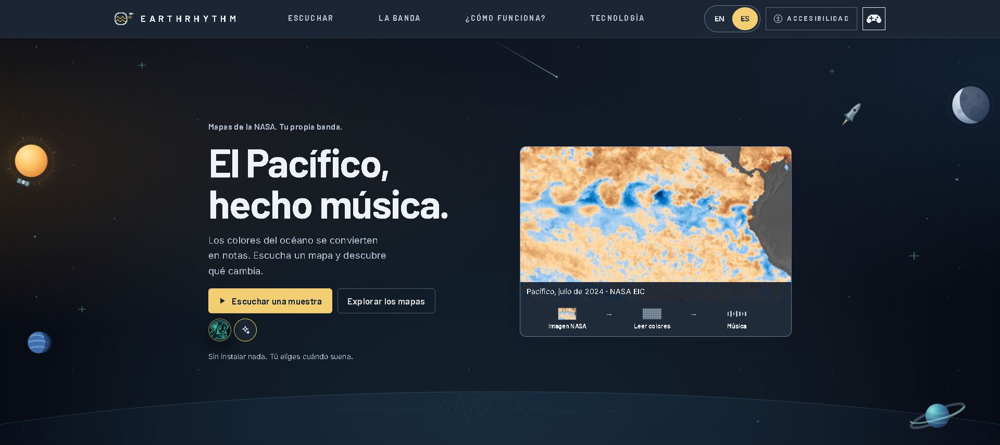

  

  <a href="https://www.linkedin.com/in/piero-v%C3%A9lez-su%C3%A1rez-36a2a6291/">Conversemos en LinkedIn ↗</a>
  &nbsp; · &nbsp;
  <a href="#proyectos">Ver proyectos ↓</a>

Soy Piero, estudiante de **Ingeniería de Sistemas y Computación en la USAT**, en Chiclayo. Me interesa crear herramientas para aprender, explorar datos y resolver problemas cercanos. En las hackathons he encontrado una buena forma de hacerlo: trabajar con otras personas, probar ideas y ver qué podemos construir juntos.

Estoy enfocando mi formación en **desarrollo backend con Java, Python y SQL**. Quiero entender bien lo que construyo, desde la base de datos hasta la experiencia de quien lo usa.

## Proyectos

Dos proyectos en equipo que cuentan un poco de ese camino. Puedes abrirlos y probarlos.

<table>
<tr>
<td width="50%" valign="top">

<h3>EarthRhythm</h3>

DATOS · MÚSICA · ACCESIBILIDAD

¿Cómo sonaría un mapa del océano? Convertimos sus colores en música para explorar el Pacífico de otra manera.

Desarrollado para <strong>NASA Space Apps 2026</strong>.

<a href="https://earthrhythm-nasa.vercel.app/">Escucharlo ↗</a> &nbsp;·&nbsp; <a href="https://github.com/pierovelezzz/EarthRhythm">Ver código</a>

</td>
<td width="50%" valign="top">

<h3>LeeContigo IA</h3>

EDUCACIÓN · IA · LECTURA

Un tutor de lectura para niños: cuentos, preguntas y pistas para acompañarlos a comprender lo que leen.

<strong>1.er lugar en futurX 2026</strong> con IngeFuturX.

<a href="https://lee-contigo-ia.vercel.app/">Leer un cuento ↗</a> &nbsp;·&nbsp; <a href="https://github.com/Alvaro-mendoza-12/Lee-Contigo-IA">Ver código</a>

</td>
</tr>
</table>

<strong>También: Valor Artesano — ponerle valor al trabajo hecho a mano</strong>

 

Un prototipo para describir una pieza, calcular costos y preparar una ficha en PDF. Las sugerencias de texto y precio funcionan con reglas en el navegador.

[Probar Valor Artesano ↗](https://valor-artesano.vercel.app/)

## Un par de hitos

- **Primer lugar en la Hackathon futurX 2026**, con el equipo IngeFuturX y LeeContigo IA. [La historia en la USAT ↗](https://www.usat.edu.pe/noticias/estudiantes-de-ingenieria-de-sistemas-y-computacion-usat-obtienen-el-primer-lugar-en-la-hackathon-futurx-2026/)
- **Primer puesto de mi carrera en 2025-II**, reconocido por la USAT. [Reconocimiento académico ↗](https://www.usat.edu.pe/noticias/usat-reconoce-a-los-primeros-puestos-de-sus-18-escuelas-profesionales/)

## Ahora mismo

**Mis bases:** `Java` · `Python` · `SQL` · `Git`  
**Lo que estoy reforzando:** Spring, PostgreSQL, autenticación y pruebas de APIs.  
**Lo que quiero seguir explorando:** educación, accesibilidad e investigación aplicada.

Me interesa colaborar en proyectos donde pueda aprender y aportar. Si estás construyendo algo por esa línea, [hablemos](https://www.linkedin.com/in/piero-v%C3%A9lez-su%C3%A1rez-36a2a6291/).

English — a little about me

I'm Piero, a Systems and Computing Engineering student at USAT in Chiclayo, Peru. I'm learning backend development with Java, Python and SQL, and I enjoy building projects around education, accessibility and data.

I was part of IngeFuturX, the team behind LeeContigo IA and first-place winner of futurX 2026. I also work on EarthRhythm, a NASA Space Apps 2026 project that turns ocean maps into music.

I'm interested in internships and collaborative projects. [Let's connect on LinkedIn ↗](https://www.linkedin.com/in/piero-v%C3%A9lez-su%C3%A1rez-36a2a6291/).

